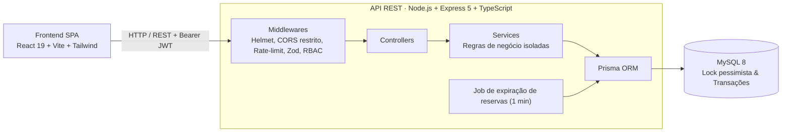

# 🎟️ EventBook

**Plataforma de venda de ingressos para eventos**, com reserva temporária concorrente, checkout atômico, check-in na portaria, cálculo de ocupação em tempo real e hardening de segurança, construída com foco em **consistência de dados** e **regras de negócio testadas**.

Organizadores criam eventos e lotes, gerenciam equipe de staff e monitoram ocupação e faturamento em tempo real. Compradores reservam com lock pessimista por 15 minutos, efetuam pagamento com checkout atômico e visualizam ingressos com cancelamento protegido por janela mínima de 12 horas. A equipe de portaria valida a entrada por código único com garantia de uso único e auditoria.

---

## Sumário

- [Funcionalidades](#funcionalidades)
- [Arquitetura](#arquitetura)
- [Stack e decisões técnicas](#stack-e-decisões-técnicas)
- [Regras de negócio](#regras-de-negócio)
- [Perfis de usuário](#perfis-de-usuário)
- [Roadmap de Milestones](#roadmap-de-milestones)
- [Endpoints da API](#endpoints-da-api)
- [Como rodar o projeto](#como-rodar-o-projeto)
- [Testes automatizados](#testes-automatizados)
- [Estrutura do repositório](#estrutura-do-repositório)
- [Documentação e ADRs](#documentação-e-adrs)

---

## Funcionalidades

| Para quem       | O que faz                                                                                                                                                              |
| --------------- | ---------------------------------------------------------------------------------------------------------------------------------------------------------------------- |
| **Comprador**   | Vitrine de eventos, reserva temporária de lotes (15 min), simulação de checkout atômico, consulta em "Meus Ingressos" e cancelamento com antecedência $\ge 12\text{h}$ |
| **Organizador** | Criação e publicação de eventos, configuração de lotes e capacidade, gestão da equipe de portaria (Staff) e métricas de ocupação/receita em tempo real                 |
| **Staff**       | Validação de ingressos na portaria digitando o código com detecção de duplicidade, bloqueio de ingressos cancelados e log de atendimento                               |
| **Admin**       | Acesso irrestrito a todas as operações de eventos, lotes, staff, pedidos e relatórios de ocupação                                                                      |

---

## Arquitetura

Monorepo estruturado com duas aplicações desacopladas e banco relacional gerenciados por Docker Compose.



### Princípios Adotados

- **Módulos por domínio:** `auth`, `events`, `lots`, `orders`, `tickets`, `event-staff`. Cada módulo isola rotas, controllers, services e schemas Zod.
- **Regras críticas isoladas:** Estoque com lock pessimista (`SELECT ... FOR UPDATE`), checkout atômico e cancelamento temporal (`$\ge 12\text{h}$`) encapsulados em transações ACID.
- **Autorização em dois níveis:** Perfil (RBAC) via middleware e posse do recurso (ownership) via service.
- **Erros padronizados:** Falhas na API respondem sempre `{ code, message, details? }` com status HTTP semânticos (400, 401, 403, 404, 409, 422, 429, 500).
- **Segurança reforçada:** Helmet (cabeçalhos HTTP seguros), CORS com allowlist restrita e Rate Limiting nas rotas críticas de autenticação (`/register` e `/login`).

---

## Stack e Decisões Técnicas

| Camada             | Tecnologia                      | Motivação                                                                           |
| ------------------ | ------------------------------- | ----------------------------------------------------------------------------------- |
| **Linguagem**      | TypeScript (`strict`)           | Tipagem estática fim a fim reduzindo bugs de regras de negócio                      |
| **API**            | Node.js + Express 5             | Alto rendimento, ecossistema maduro e controle total sobre middlewares              |
| **Segurança**      | Helmet + Rate Limit + CORS      | Proteção contra clickjacking, MIME sniffing, brute-force e requisições cross-origin |
| **Validação**      | Zod                             | Validação declarativa de entrada com inferência automática de tipos TypeScript      |
| **Autenticação**   | JWT + bcryptjs                  | Tokens stateless para SPA com hashing seguro de senhas                              |
| **Banco de Dados** | MySQL 8                         | Transações ACID completas e locks pessimistas contra concorrência                   |
| **ORM**            | Prisma 6                        | Migrations versionadas, schemas declarativos e integridade referencial              |
| **Frontend**       | React 19 + Vite + Tailwind CSS  | Interface ultra-rápida, estilização consistente e componentes modernos              |
| **Testes**         | Vitest + Supertest + Playwright | Testes unitários, integração com MySQL real e E2E completo no navegador             |
| **CI/CD**          | GitHub Actions                  | Pipeline com lint, typecheck, build, testes e Playwright E2E em toda PR             |

---

## Regras de Negócio

| RN        | Regra                                                                                                   | Implementação                                 |
| --------- | ------------------------------------------------------------------------------------------------------- | --------------------------------------------- |
| **RN-01** | Eventos passados não podem ser editados; publicação requer pelo menos um lote ativo                     | `backend/src/services/events.service.ts`      |
| **RN-02** | Reservas somente dentro da janela de vendas do lote com estoque positivo                                | `backend/src/services/orders.service.ts`      |
| **RN-03** | Proteção contra overselling sob concorrência via lock pessimista no MySQL                               | `backend/src/services/orders.service.ts`      |
| **RN-04** | Reserva temporária expira em exatamente 15 minutos liberando estoque                                    | Job periódico + verificação lazy              |
| **RN-05** | Checkout atômico: pedido marcado como `PAID` e emissão de ingressos com código único na mesma transação | `backend/src/services/orders.service.ts`      |
| **RN-06** | Cancelamento de pedido pago permitido apenas com antecedência $\ge 12\text{h}$ antes do evento          | `backend/src/services/orders.service.ts`      |
| **RN-07** | Gestão de equipe de Staff restrita a organizador e admin do evento                                      | `backend/src/services/event-staff.service.ts` |
| **RN-08** | Check-in de ingresso com uso único, validação de equipe e janela de entrada                             | `backend/src/services/checkin.service.ts`     |
| **RN-09** | Snapshot de preço do lote fixado no momento da criação do pedido                                        | `backend/src/services/orders.service.ts`      |
| **RN-10** | Ocupação e receita calculadas via agregação SQL nativa (`SUM`/`COUNT`)                                  | `backend/src/services/events.service.ts`      |

---

## Roadmap de Milestones

| Milestone | Descrição                                                                    | Status       |
| --------- | ---------------------------------------------------------------------------- | ------------ |
| **M01**   | Fundação, infraestrutura, CI e testes                                        | ✅ Concluída |
| **M02**   | Autenticação e perfis (RBAC)                                                 | ✅ Concluída |
| **M03**   | Gestão de eventos                                                            | ✅ Concluída |
| **M04**   | Lotes e capacidade                                                           | ✅ Concluída |
| **M05**   | Pedido e reserva temporária com lock pessimista (RN-02, RN-03, RN-04, RN-09) | ✅ Concluída |
| **M06**   | Checkout atômico, geração de ingressos e cancelamento com 12h (RN-05, RN-06) | ✅ Concluída |
| **M07**   | Gestão de equipe (Staff) e check-in na portaria (RN-07, RN-08)               | ✅ Concluída |
| **M08**   | Métricas de ocupação e faturamento em tempo real (RN-10)                     | ✅ Concluída |
| **M09**   | Hardening de segurança, Playwright E2E, OpenAPI e Release v1.0.0             | ✅ Concluída |

---

## Endpoints da API

A especificação completa OpenAPI 3.0 está disponível em [`docs/openapi.yaml`](docs/openapi.yaml).

| Método   | Endpoint                    | Acesso                  | Descrição                                             |
| -------- | --------------------------- | ----------------------- | ----------------------------------------------------- |
| `GET`    | `/health`                   | Público                 | Verificação de status e saúde da API                  |
| `POST`   | `/register`                 | Público                 | Cadastro de usuário (rate limit ativo)                |
| `POST`   | `/login`                    | Público                 | Autenticação JWT (rate limit ativo)                   |
| `GET`    | `/me`                       | Autenticado             | Dados do usuário autenticado                          |
| `GET`    | `/events`                   | Público                 | Listagem paginada de eventos públicos                 |
| `GET`    | `/events/:id`               | Público / Dono          | Detalhes do evento e lotes de venda                   |
| `POST`   | `/events`                   | ORGANIZER, ADMIN        | Criação de novo evento (status `DRAFT`)               |
| `PUT`    | `/events/:id`               | Dono, ADMIN             | Atualização do evento (RN-01)                         |
| `PATCH`  | `/events/:id/publish`       | Dono, ADMIN             | Publicação do evento com lotes (RN-01)                |
| `GET`    | `/events/:id/occupancy`     | Dono, ADMIN             | Métricas de ocupação e receita em tempo real (RN-10)  |
| `GET`    | `/events/:id/staff`         | Dono, ADMIN             | Listar membros da equipe vinculados (RN-07)           |
| `POST`   | `/events/:id/staff`         | Dono, ADMIN             | Vincular novo membro de staff (RN-07)                 |
| `DELETE` | `/events/:id/staff/:userId` | Dono, ADMIN             | Desvincular membro da equipe                          |
| `GET`    | `/events/:id/lots`          | Público (ativos) / Dono | Listagem de lotes de ingressos                        |
| `POST`   | `/events/:id/lots`          | Dono, ADMIN             | Criação de lote com validação de capacidade           |
| `PUT`    | `/lots/:id`                 | Dono, ADMIN             | Edição de lote existente                              |
| `DELETE` | `/lots/:id`                 | Dono, ADMIN             | Exclusão de lote                                      |
| `POST`   | `/orders`                   | Autenticado (BUYER)     | Reserva de ingressos por 15 min (RN-02, RN-03)        |
| `GET`    | `/orders/me`                | Autenticado             | Listagem dos pedidos do comprador                     |
| `GET`    | `/orders/:id`               | Dono, ADMIN             | Consulta detalhada do pedido                          |
| `POST`   | `/orders/:id/checkout`      | Dono, ADMIN             | Checkout atômico e emissão de ingressos (RN-05)       |
| `POST`   | `/orders/:id/cancel`        | Dono, ADMIN             | Cancelamento de pedido com verificação de 12h (RN-06) |
| `GET`    | `/tickets/me`               | Autenticado             | Listagem dos ingressos do comprador                   |
| `GET`    | `/tickets/:code`            | Autenticado             | Detalhes do ingresso por código                       |
| `POST`   | `/tickets/:code/checkin`    | STAFF, Dono, ADMIN      | Realização de check-in na portaria (RN-07, RN-08)     |

---

## Como Rodar o Projeto

### Pré-requisitos

- Node.js 22 LTS ou superior
- Docker Desktop e Docker Compose
- Git

### 1. Iniciar o Banco de Dados MySQL

```bash
docker compose up -d mysql
```

### 2. Configurar e Iniciar o Back-end

```bash
cd backend
cp .env.example .env
npm install
npx prisma migrate dev
npm run db:seed
npm run dev
# API disponível em http://localhost:3333
```

### 3. Configurar e Iniciar o Front-end

```bash
cd frontend
npm install
npm run dev
# Aplicação disponível em http://localhost:5173
```

---

## Testes Automatizados

### Backend (Testes Unitários, Segurança e Integração)

```bash
cd backend
npm run lint && npm run typecheck
npm test
npm run test:integration
```

### Frontend (Testes de Componentes e Serviços)

```bash
cd frontend
npm run lint && npm run typecheck
npm test
```

### E2E com Playwright (Fluxo Completo: Cadastro $\to$ Compra $\to$ Check-in)

```bash
cd frontend
npm run test:e2e
```

---

## Estrutura do Repositório

```
eventbook/
├── backend/               # API Express, Prisma ORM, middlewares e testes
│   ├── prisma/            # Schemas, migrations e seeds
│   ├── src/               # Módulos de domínio, rotas e serviços
│   └── tests/             # Testes unitários, de segurança e integração MySQL
├── frontend/              # SPA React 19, Tailwind CSS e testes
│   ├── src/               # Páginas, componentes, hooks e serviços
│   └── e2e/               # Testes ponta a ponta com Playwright
├── docs/                  # Documentação técnica, regras de negócio e ADRs
│   ├── adr/               # Architecture Decision Records (0001 a 0005)
│   └── openapi.yaml       # Especificação completa OpenAPI 3.0
├── .github/workflows/     # Pipeline de CI/CD (GitHub Actions)
└── docker-compose.yml     # Orquestração local do ambiente
```

---

## Documentação e ADRs

| Documento                                                                                                        | Descrição                                                |
| ---------------------------------------------------------------------------------------------------------------- | -------------------------------------------------------- |
| [`docs/openapi.yaml`](docs/openapi.yaml)                                                                         | Especificação OpenAPI 3.0 de todos os endpoints          |
| [`docs/regras-de-negocio.md`](docs/regras-de-negocio.md)                                                         | Detalhamento das regras RN-01 a RN-10                    |
| [`docs/erd.md`](docs/erd.md)                                                                                     | Diagrama Entidade-Relacionamento e modelo de dados       |
| [`docs/perfis-e-permissoes.md`](docs/perfis-e-permissoes.md)                                                     | Matriz RBAC de perfis e permissões                       |
| [`docs/convencoes.md`](docs/convencoes.md)                                                                       | Padrões de código, commits convencionais e fluxo de PRs  |
| [`docs/adr/0001-concorrencia-e-expiracao.md`](docs/adr/0001-concorrencia-e-expiracao.md)                         | ADR 0001: Lock pessimista e expiração de reserva         |
| [`docs/adr/0002-checkout-atomico-e-cancelamento.md`](docs/adr/0002-checkout-atomico-e-cancelamento.md)           | ADR 0002: Transação de checkout e cancelamento com 12h   |
| [`docs/adr/0003-controle-de-acesso-staff-e-checkin.md`](docs/adr/0003-controle-de-acesso-staff-e-checkin.md)     | ADR 0003: Vínculo de staff e check-in com uso único      |
| [`docs/adr/0004-ocupacao-e-metricas-em-tempo-real.md`](docs/adr/0004-ocupacao-e-metricas-em-tempo-real.md)       | ADR 0004: Agregação SQL nativa para métricas de ocupação |
| [`docs/adr/0005-hardening-de-seguranca-e-resiliencia.md`](docs/adr/0005-hardening-de-seguranca-e-resiliencia.md) | ADR 0005: Hardening de segurança, CORS e Rate Limiting   |
