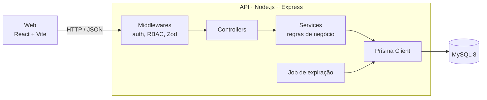

# 🎟️ EventBook

**Plataforma de venda de ingressos para eventos**, com reserva temporária, checkout atômico e check-in na porta, construída com foco em **consistência de dados** e **regras de negócio testadas**.

Organizadores criam eventos e lotes. Compradores reservam e pagam (checkout simulado). A equipe valida a entrada por código. Em todo o fluxo, o sistema impede a venda de mais ingressos do que o estoque, mesmo sob requisições simultâneas.

---

## Sumário

- [Funcionalidades](#funcionalidades)
- [Arquitetura](#arquitetura)
- [Stack e decisões técnicas](#stack-e-decisões-técnicas)
- [Regras de negócio](#regras-de-negócio)
- [Perfis de usuário](#perfis-de-usuário)
- [Roadmap](#roadmap)
- [Como rodar](#como-rodar)
- [Testes](#testes)
- [Estrutura do repositório](#estrutura-do-repositório)
- [Como contribuir](#como-contribuir)
- [Documentação](#documentação)

---

## Funcionalidades

| Para quem | O que faz |
|---|---|
| **Comprador** | Vê a vitrine de eventos, escolhe lotes, reserva ingressos por 15 minutos, paga, consulta "Meus Ingressos" e cancela dentro do prazo |
| **Organizador** | Cria e publica eventos, define lotes e capacidade, monta a equipe e acompanha a ocupação em tempo real |
| **Staff** | Valida ingressos na entrada digitando o código, com retorno claro de permitido, duplicado ou recusado |

## Arquitetura

Monorepo com duas aplicações e um banco, orquestrados por Docker Compose. A API segue camadas simples: cada requisição passa por middlewares, controllers, services (onde ficam as regras) e Prisma.



Princípios adotados:

- **Módulos por domínio.** Cada módulo (`auth`, `events`, `lots`, `orders`...) mantém rota, controller, service e schema juntos.
- **Regras críticas isoladas.** Estoque, checkout e janela de check-in ficam em arquivos próprios, fáceis de testar e revisar.
- **Autorização em dois níveis.** Perfil (RBAC) no middleware e propriedade do recurso no service.
- **Erros padronizados.** Toda falha da API responde `{ code, message, details }`.
- **Datas em UTC.** A conversão para o fuso do usuário acontece só na interface.

## Stack e decisões técnicas

| Camada | Tecnologia | Por que foi escolhida |
|---|---|---|
| Linguagem | **TypeScript** (`strict`) | Tipagem de ponta a ponta reduz erros em regras com muitos estados (pedido, ticket, check-in) |
| API | **Node.js + Express** | Simples, amplamente conhecido e suficiente para uma API REST bem estruturada |
| Validação | **Zod** | Valida payloads e variáveis de ambiente com o mesmo esquema que gera os tipos |
| Autenticação | **JWT + bcryptjs** | Autenticação sem estado, adequada para API e SPA. O `bcryptjs` evita compilação nativa, o que facilita no Windows |
| Banco | **MySQL 8** | Banco relacional com transações e locks, necessários para impedir overselling e garantir o checkout atômico |
| ORM | **Prisma** | Schema declarativo, migrations versionadas e transações com tipagem |
| Front-end | **React + Vite** | Desenvolvimento rápido com hot reload e build enxuto |
| Estilização | **Tailwind CSS** | Velocidade para montar telas e estados de interface consistentes |
| Testes | **Vitest, Supertest, Testing Library, Playwright** | Unidade e integração com a mesma ferramenta, mais E2E do fluxo principal |
| Infra | **Docker Compose** | Um comando sobe front, API e banco, com o mesmo ambiente para todos |
| CI/CD | **GitHub Actions** | Lint, typecheck, build e testes em toda PR, com a `main` protegida |

> **Versões fixadas:** TypeScript em `~5.9` (compatibilidade com o `typescript-eslint`) e Prisma em `6`.

## Regras de negócio

As 10 regras (RN-01 a RN-10) guiam o desenvolvimento e cada uma tem teste automatizado. Resumo:

| RN | Regra |
|---|---|
| RN-01 | Evento passado não pode ser editado, e evento sem lotes não pode ser publicado |
| RN-02 | Só se reserva dentro da janela de venda do lote, respeitando o estoque remanescente |
| RN-03 | Nunca vender acima do estoque, mesmo com requisições concorrentes (409) |
| RN-04 | Reserva expira em 15 minutos e devolve o estoque |
| RN-05 | Checkout atômico: pedido pago e tickets gerados juntos, ou nada |
| RN-06 | Cancelamento bloqueado a menos de 12h do evento |
| RN-07 | Check-in só para ticket existente, do evento correto e ainda não usado |
| RN-08 | Check-in permitido de 2h antes do início até o fim do evento |
| RN-09 | O preço do lote é gravado no pedido no momento da reserva |
| RN-10 | Números de ocupação calculados por agregação no banco |

Detalhes e critérios de aceite em [`docs/regras-de-negocio.md`](docs/regras-de-negocio.md).

## Perfis de usuário

| Perfil | Papel |
|---|---|
| `BUYER` | Compra ingressos. É o perfil de todo cadastro público |
| `ORGANIZER` | Gerencia os próprios eventos, lotes, equipe e ocupação |
| `STAFF` | Faz check-in nos eventos aos quais está vinculado |
| `ADMIN` | Reservado para evolução futura |

Matriz completa por endpoint em [`docs/perfis-e-permissoes.md`](docs/perfis-e-permissoes.md).

## Roadmap

O desenvolvimento segue milestones, cada uma com issues atômicas no GitHub Projects e o fluxo `Issue → Branch → Commit → PR → Review → Merge`.

| Milestone | Escopo | Status |
|---|---|---|
| M01 | Fundação, infraestrutura, CI e testes | ✅ Concluída |
| M02 | Autenticação e perfis (RBAC) | ✅ Concluída |
| M03 | Gestão de eventos | ✅ Concluída |
| M04 | Lotes e capacidade | ✅ Concluída |
| M05 | Pedido e reserva temporária | ⏳ Próxima |
| M06 | Checkout atômico e cancelamento | ⏳ Planejada |
| M07 | Staff e check-in | ⏳ Planejada |
| M08 | Ocupação | ⏳ Planejada |
| M09 | Hardening e release | ⏳ Planejada |

**Endpoints disponíveis**

| Método | Rota | Acesso | Descrição |
|---|---|---|---|
| `GET` | `/health` | Público | Healthcheck da API |
| `POST` | `/register` | Público | Cadastro de novo usuário (BUYER) |
| `POST` | `/login` | Público | Autenticação com JWT |
| `GET` | `/me` | Autenticado | Perfil do usuário autenticado |
| `GET` | `/events` | Público | Listagem paginada de eventos publicados |
| `GET` | `/events/:id` | Público / Dono | Detalhes do evento com lotes ativos |
| `POST` | `/events` | ORGANIZER, ADMIN | Criação de evento (DRAFT) |
| `PATCH` | `/events/:id` | Dono, ADMIN | Edição de evento (RN-01: bloqueia passado) |
| `POST` | `/events/:id/publish` | Dono, ADMIN | Publicação de evento (RN-01: requer lotes) |
| `GET` | `/events/:id/lots` | Público (ativos) / Dono (todos) | Listagem de lotes de um evento |
| `POST` | `/events/:id/lots` | Dono, ADMIN | Cadastro de lote (valida capacidade e datas) |
| `PATCH` | `/events/:id/lots/:lotId` | Dono, ADMIN | Edição de lote (revalida capacidade) |

## Como rodar

**Pré-requisitos:** Node.js 22 LTS ou superior, Docker com Compose e Git.

```bash
# 1. Banco de dados
docker compose up -d mysql

# 2. Back-end
cd backend
cp .env.example .env          # ajuste DATABASE_URL, JWT_SECRET e SEED_PASSWORD
npm install
npx prisma migrate dev
npm run db:seed
npm run dev                   # http://localhost:3333

# 3. Front-end (em outro terminal)
cd frontend
npm install
npm run dev                   # http://localhost:5173
```

Usuários criados pelo seed (a senha é a definida em `SEED_PASSWORD`):

| Perfil | E-mail |
|---|---|
| ADMIN | `admin@eventbook.test` |
| ORGANIZER | `organizer@eventbook.test` |
| STAFF | `staff@eventbook.test` |
| BUYER | `buyer@eventbook.test` |

O passo a passo completo de instalação, com todos os comandos e configurações, está em [`docs/setup-ambiente.md`](docs/setup-ambiente.md).

## Testes

```bash
cd backend
npm run lint && npm run typecheck
npm test
```

Os testes de integração rodam contra um banco isolado (`eventbook_test`), configurado em `backend/.env.test`. As regras mais sensíveis têm testes dedicados: concorrência do overselling (RN-03), rollback do checkout (RN-05) e bordas de horário (RN-02, RN-06 e RN-08).

## Estrutura do repositório

```
eventbook/
├── backend/     # Back-end: Express, Prisma, testes
├── frontend/    # Front-end: React, Vite, Tailwind CSS
├── docs/        # Regras de negócio, ERD, perfis, convenções, setup
├── e2e/         # Testes ponta a ponta (a partir da M09)
└── .github/     # CI, templates de issue e PR, CODEOWNERS
```

## Como contribuir

1. Escolha uma issue em *Ready* no board do projeto.
2. Crie a branch no formato `tipo/numero-descricao`, por exemplo `feat/42-post-orders`.
3. Faça commits no padrão Conventional Commits (`feat(api): add POST /orders`).
4. Abra a PR com `Closes #<issue>`, com o CI verde e pelo menos 1 aprovação.

Todas as convenções estão em [`docs/convencoes.md`](docs/convencoes.md).

## Documentação

| Documento | Conteúdo |
|---|---|
| [Regras de negócio](docs/regras-de-negocio.md) | RN-01 a RN-10 com critérios de aceite |
| [Modelo de dados](docs/erd.md) | ERD, tabelas por milestone e restrições |
| [Perfis e permissões](docs/perfis-e-permissoes.md) | Matriz de acesso por endpoint |
| [Convenções](docs/convencoes.md) | Branches, commits, PRs, formato de erros e Definition of Done |
| [Setup do ambiente](docs/setup-ambiente.md) | Instalação e configuração passo a passo |
