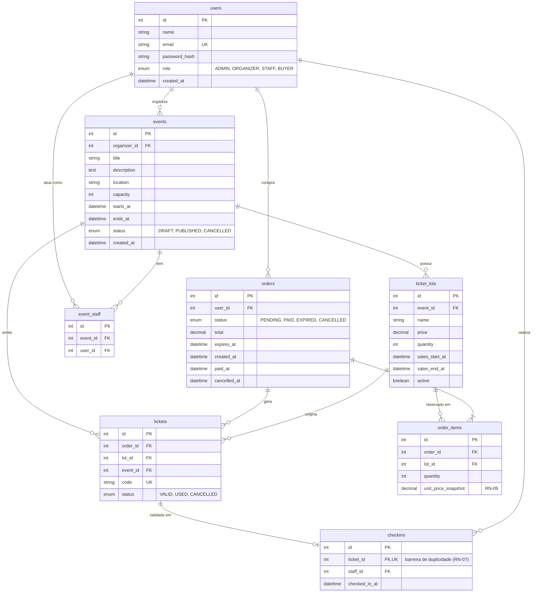

# Modelo de Dados (ERD inicial)

Versão inicial. Cada tabela é criada na milestone indicada, e o modelo é refinado durante o desenvolvimento. Datas em UTC.

## Tabelas por milestone

| Milestone | Tabelas |
|---|---|
| M02 | `users` |
| M03 | `events` |
| M04 | `ticket_lots` |
| M05 | `orders`, `order_items` |
| M06 | `tickets` |
| M07 | `event_staff`, `checkins` |

## Restrições importantes

- `users.email` é único.
- `tickets.code` é único (RN-05).
- `checkins.ticket_id` é único: o banco impede check-in duplicado, mesmo sob concorrência (RN-07).
- `event_staff (event_id, user_id)` é único.
- Índices previstos: `orders (status, expires_at)` para a expiração (RN-04) e `order_items (lot_id)` para o cálculo de estoque (RN-02).
- Regra de capacidade (M04): a soma de `ticket_lots.quantity` de um evento não pode exceder `events.capacity`.
